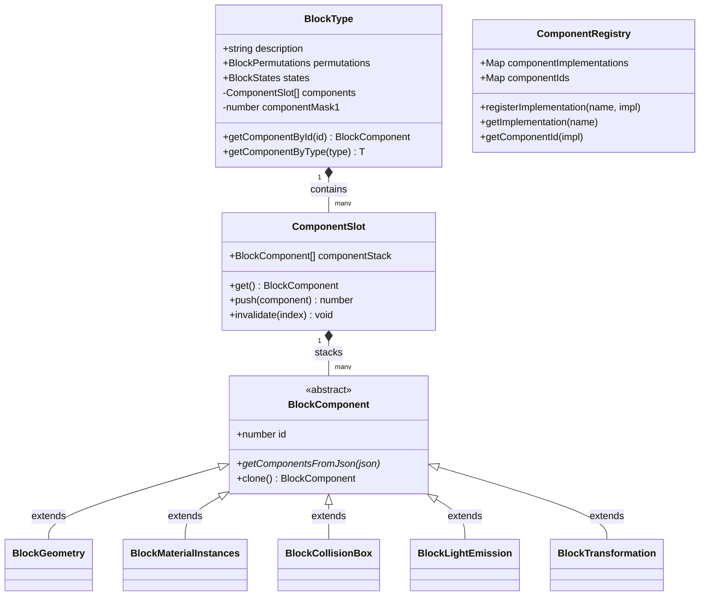

# Block Component Architecture

This document describes the component-based architecture of WebCraft's block rendering engine, detailing how it supports the standard Minecraft Bedrock Edition Addon API while maintaining maximum performance on web platforms.

---

## 1. Overview & Goals

In Minecraft Bedrock Edition, blocks are defined as data-driven JSON objects composed of modular components (e.g., `minecraft:geometry`, `minecraft:material_instances`, `minecraft:light_emission`, etc.). 

To render these blocks efficiently in a browser (targeting 60+ FPS on low-end and mobile hardware), WebCraft maps Bedrock's JSON components to optimized TypeScript classes. Our implementation goals are:
1. **Addon Compatibility**: Mirror the Bedrock JSON schema for block components, permutations, and states.
2. **Minimal Memory Footprint**: Store only the components present on a given block, avoiding empty slots or expensive hash map lookups.
3. **High-Performance Lookups**: Ensure component retrieval is an $O(1)$ operation without introducing pointer-chasing overhead.
4. **Dynamic Overrides**: Allow components to change dynamically at runtime based on block state queries (permutations) without copying block definitions.

---

## 2. Core Architecture & Classes

The architecture is divided into registration, representation, and storage.



### 2.1 [BlockComponent](file:///home/mihnea/web/webcraft/engine/block/blockType/components/base.ts)
The abstract base class for all block components. It contains:
- `static id`: A unique bitmask value from the `Components` enum.
- `getComponentsFromJson(json)`: A generator that parses component JSON definitions, looks up their registered classes, and instantiates them.
- `clone()`: A shallow/prototype copy helper.

### 2.2 [ComponentRegistry](file:///home/mihnea/web/webcraft/engine/block/blockType/componentRegistry.ts)
A global registry class containing:
- `componentImplementations`: Maps JSON string names (e.g., `"minecraft:geometry"`, `"geometry"`) to their constructors.
- `componentIds`: Automatically assigns an incremental ID (`componentCnt++`) to registered component classes.
- Methods to register and fetch implementations.

### 2.3 [Components Enum](file:///home/mihnea/web/webcraft/engine/block/blockType/componentEnum.ts)
Defines bitmask values for first-class components. Using powers of two allows lookups using bitwise operations:
```typescript
export const enum Components {
    Description = 0,
    MenuCategory = 3,
    Geometry = 1 << 0,             // 1
    MaterialInstances = 1 << 1,    // 2
    CollisionBox = 1 << 2,         // 4
    LightEmission = 1 << 3,        // 8
    SelectionBox = 1 << 4,         // 16
    Transformation = 1 << 5,       // 32
}
```

---

## 3. High Performance: Bitmask Indexed Dense Storage

To avoid allocating space for absent components or doing string-based lookups, WebCraft uses a **Bitmask Indexed Dense Array** (a type of Sparse-to-Dense Indexing) inside [`BlockType`](file:///home/mihnea/web/webcraft/engine/block/blockType/type.ts).

### How it works:
1. **Build the Mask**: During initialization, the block type compiles a bitwise OR mask of all components it could possibly possess (including those defined in active or inactive permutations):
   ```typescript
   this.componentMask1 |= (component.constructor as any).id;
   ```
2. **Allocate Dense Array**: It allocates an array exactly sized to the number of components present.
3. **Sparse-to-Dense Lookup**: When looking up a component by its bitmask `id`, we locate its index in the dense array using bitwise logic and `popcount` (which counts the number of set bits):
   ```typescript
   getComponentImdexInComponentArray(id: Components) {
       const mask1 = this.componentMask1;
       if (mask1 & id) {
           // Mask out all bits at and above the target ID
           const tail = mask1 & (id - 1);
           // Index is the count of set bits before our target ID bit
           return popcount32(tail);
       }
       return -1;
   }
   ```

This approach yields:
* **Zero wasted array elements** for components the block doesn't use.
* **$O(1)$ lookup time** using fast bitwise operations.

---

## 4. Bedrock Addon Support: Permutations & Component Stacks

Minecraft Bedrock addons allow components to be overwritten dynamically based on block state. For example, when a block's `direction` state changes, it might trigger a permutation rule adding a new `minecraft:transformation` (rotation) component.

To support this without constantly reconstructing components or cloning `BlockType` definitions, WebCraft uses a stack-based **`ComponentSlot`** for each component:

### 4.1 Component Overrides via [ComponentSlot](file:///home/mihnea/web/webcraft/engine/block/blockType/componentRegistry.ts)
Instead of storing raw `BlockComponent` instances directly, the dense components array contains `ComponentSlot` wrappers:
```typescript
export class ComponentSlot<T extends BlockComponent> {
    componentStack: (T | null)[] = [];

    get() {
        return this.componentStack.at(-1) ?? null;
    }

    push(component: T) {
        this.componentStack.push(component);
        return this.componentStack.length - 1;
    }

    invalidate(index: number = -1) {
        // Sets slot to null and pops trailing nulls
        this.componentStack[index] = null;
        if (index == this.componentStack.length - 1) {
            this.continiousPop();
        }
    }
}
```

### 4.2 Handling Block Permutations
1. **Base Load**: The base components from the block JSON are loaded first and pushed to their respective slots (becoming index `0` of the `componentStack`).
2. **Permutation Extraction**: Permutations defined under `"permutations"` are parsed via [`BlockPermutations`](file:///home/mihnea/web/webcraft/engine/block/blockType/components/permutations.ts). The block states involved in condition queries (e.g., `q.block_state('direction')`) are extracted.
3. **Runtime Permutation Activation**:
   - When a block state changes, WebCraft evaluates the permutation rules.
   - If a permutation condition becomes `true`, the permutation's overriding components are pushed onto their corresponding `ComponentSlot` stack.
   - Subsequent calls to `getComponentById()` automatically retrieve the top component in the stack, representing the override.
   - When the permutation condition becomes `false`, the component is marked invalid (`null`), exposing the default base component (or next active permutation) beneath it.

---

## 5. Guide: Creating and Registering a New Component

To implement support for a new Bedrock component:

### Step 1: Add it to the Enum
Add a bitmask entry to [`Components`](file:///home/mihnea/web/webcraft/engine/block/blockType/componentEnum.ts):
```typescript
export const enum Components {
    // ... existing components
    NewComponent = 1 << 6, // 64
}
```

### Step 2: Implement the Component Class
Create a new file in [`engine/block/blockType/components/`](file:///home/mihnea/web/webcraft/engine/block/blockType/components) (e.g., `newComponent.ts`):
```typescript
import { Components } from "../componentEnum";
import { componentRegistry } from "../type";
import { BlockComponent } from "./base";

export class BlockNewComponent extends BlockComponent {
    public static id = Components.NewComponent;
    public myValue: number = 0;

    constructor(json: any) {
        super();
        if (typeof json === "number") {
            this.myValue = json;
        } else if (json && typeof json === "object") {
            this.myValue = json.value ?? 0;
        }
    }
}

// Register the class with the global registry using its Bedrock names
componentRegistry.registerImplementation("minecraft:new_component", BlockNewComponent);
componentRegistry.registerImplementation("new_component", BlockNewComponent);
```

### Step 3: Import your component
Ensure your new file is imported in [`type.ts`](file:///home/mihnea/web/webcraft/engine/block/blockType/type.ts) or during boot to trigger the global registry registration side effects.

---

## See Also
* [GPU Geometry Cube Layout Specification](file:///home/mihnea/web/webcraft/docs/cube-layout.md) — How the CPU bakers serialize layout data for the WebGPU shader.
* [Overview](file:///home/mihnea/web/webcraft/docs/overview.md) — General WebCraft project overview.
